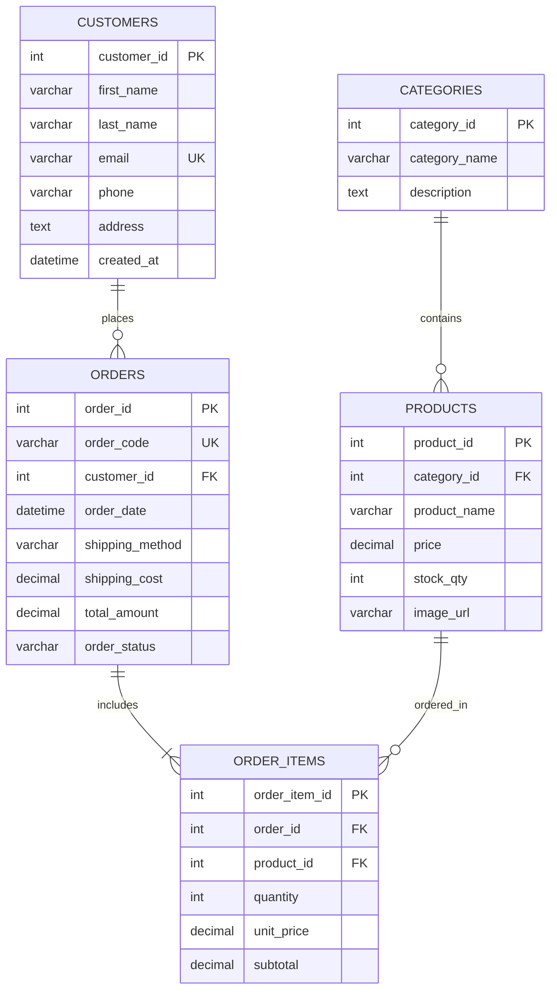

# E-Commerce Web Application & Database Design

This project contains the complete solution for **Practical Exercises 1–4** based on the assignment requirements.

---

## 🚀 Step 1: Getting Started

### 1. Install dependencies
```bash
npm install
```

### 2. Run the development server
```bash
npm run dev
```

Open your browser and navigate to the localhost URL shown (typically `http://localhost:5173`).

---

## 📦 Features Overview

### Practical Exercise 1: Products & Shopping Cart
* **4 Products Display:**
  * **Laptop** — $650.00
  * **Mouse** — $15.00
  * **Keyboard** — $25.00
  * **Monitor** — $120.00
* **Add to Cart** with dynamic badge counter and toast notifications.
* **Shopping Cart Page:**
  * View list of cart items with quantity, unit price, and subtotal.
  * **Update QTY:** Increment (`+`) and decrement (`−`).
  * **Remove Item:** Delete button / trash icon to remove the product from cart.
  * **Order Summary:** Automatic calculation of Subtotal and Grand Total.
  * **Proceed to Checkout** button.

### Practical Exercise 2: Checkout Form
* **Customer Data Collection:**
  * First Name *
  * Last Name *
  * Email *
  * Phone Number *
  * Address *
* **Required-Field Validation:** Validates required entries and email format with error alerts.
* **Shipping Method Selection:**
  * Free Shipping ($0, 7–20 Days)
  * Express Shipping ($9, 1–3 Days)
* **Real-time Order Summary:** Displays items, subtotal, shipping cost, and dynamic grand total.
* **Place Order Button** to trigger submission.

### Practical Exercise 3: Order Confirmation
* Displays success alert: `"Order Placed Successfully!"`.
* Generates auto-incrementing Order ID: `ORD-0001`, `ORD-0002`, etc.
* Customer Name and Order Date.
* Ordered Products table with quantities, prices, and item subtotals.
* Total Amount calculation.
* Order Status set to `Pending`.

---

## 🗄️ Practical Exercise 4: Database Design (ERD)

### Mermaid Entity-Relationship Diagram (ERD)



### Table Relationships

| Relationship | Type | Explanation |
| :--- | :--- | :--- |
| **CUSTOMERS → ORDERS** | `1:N` (One-to-Many) | One customer can place multiple orders; each order belongs to one customer. |
| **CATEGORIES → PRODUCTS** | `1:N` (One-to-Many) | One category contains multiple products; each product belongs to one category. |
| **ORDERS → ORDER_ITEMS** | `1:N` (One-to-Many) | One order contains one or more line items (`ORDER_ITEMS`). |
| **PRODUCTS → ORDER_ITEMS** | `1:N` (One-to-Many) | One product can appear in multiple order line items. |

*(Note: `ORDER_ITEMS` acts as the junction table resolving the Many-to-Many (`M:N`) relationship between `ORDERS` and `PRODUCTS`.)*

### SQL DDL Scripts (PostgreSQL / MySQL)

```sql
-- 1. Categories Table
CREATE TABLE categories (
    category_id INT AUTO_INCREMENT PRIMARY KEY,
    category_name VARCHAR(100) NOT NULL,
    description TEXT
);

-- 2. Products Table
CREATE TABLE products (
    product_id INT AUTO_INCREMENT PRIMARY KEY,
    category_id INT NOT NULL,
    product_name VARCHAR(150) NOT NULL,
    price DECIMAL(10, 2) NOT NULL,
    stock_qty INT DEFAULT 0,
    image_url VARCHAR(255),
    FOREIGN KEY (category_id) REFERENCES categories(category_id) ON DELETE CASCADE
);

-- Sample Products Insert with real image URLs
INSERT INTO products (category_id, product_name, price, stock_qty, image_url) VALUES
(1, 'Laptop', 650.00, 50, 'https://images.unsplash.com/photo-1496181133206-80ce9b88a853?auto=format&fit=crop&w=600&q=80'),
(2, 'Mouse', 15.00, 200, 'https://images.unsplash.com/photo-1527864550417-7fd91fc51a46?auto=format&fit=crop&w=600&q=80'),
(2, 'Keyboard', 25.00, 150, 'https://images.unsplash.com/photo-1587829741301-dc798b83add3?auto=format&fit=crop&w=600&q=80'),
(3, 'Monitor', 120.00, 80, 'https://images.unsplash.com/photo-1527443224154-c4a3942d3acf?auto=format&fit=crop&w=600&q=80');

-- 3. Customers Table
CREATE TABLE customers (
    customer_id INT AUTO_INCREMENT PRIMARY KEY,
    first_name VARCHAR(100) NOT NULL,
    last_name VARCHAR(100) NOT NULL,
    email VARCHAR(150) UNIQUE NOT NULL,
    phone VARCHAR(30) NOT NULL,
    address TEXT NOT NULL,
    created_at TIMESTAMP DEFAULT CURRENT_TIMESTAMP
);

-- 4. Orders Table
CREATE TABLE orders (
    order_id INT AUTO_INCREMENT PRIMARY KEY,
    order_code VARCHAR(50) UNIQUE NOT NULL,
    customer_id INT NOT NULL,
    order_date TIMESTAMP DEFAULT CURRENT_TIMESTAMP,
    shipping_method VARCHAR(50) NOT NULL,
    shipping_cost DECIMAL(10, 2) DEFAULT 0.00,
    total_amount DECIMAL(10, 2) NOT NULL,
    order_status VARCHAR(50) DEFAULT 'Pending',
    FOREIGN KEY (customer_id) REFERENCES customers(customer_id) ON DELETE CASCADE
);

-- 5. Order_Items Table (Junction Table)
CREATE TABLE order_items (
    order_item_id INT AUTO_INCREMENT PRIMARY KEY,
    order_id INT NOT NULL,
    product_id INT NOT NULL,
    quantity INT NOT NULL CHECK (quantity > 0),
    unit_price DECIMAL(10, 2) NOT NULL,
    subtotal DECIMAL(10, 2) NOT NULL,
    FOREIGN KEY (order_id) REFERENCES orders(order_id) ON DELETE CASCADE,
    FOREIGN KEY (product_id) REFERENCES products(product_id) ON DELETE RESTRICT
);
```

